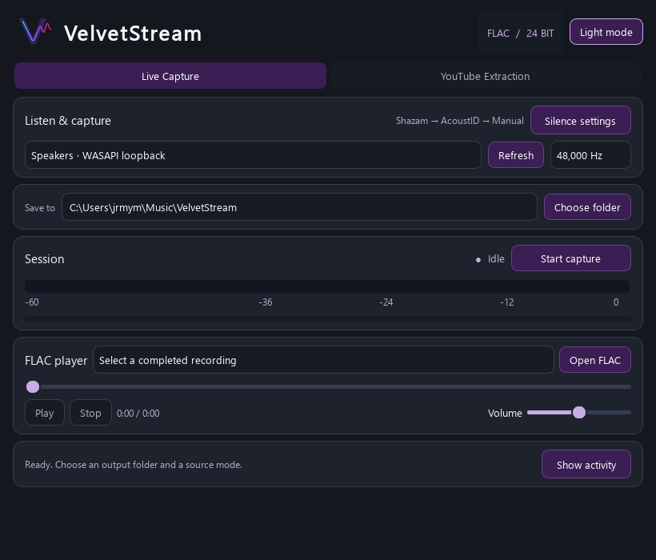

# VelvetStream

Video links extract only the selected video, even when the copied URL includes
playlist, index, or radio parameters. Batch extraction requires an explicit
`https://www.youtube.com/playlist?list=...` link. Retry skips an already saved video.

A complete modular PySide6 desktop application with charcoal/velvet-purple styling and the approved velvet-purple soundwave logo,
an accessible light theme, rounded controls, fading source panels, a painted
60 Hz VU meter, and background live capture / YouTube extraction.



The runnable entry point is `velvetstream.py`. A complete single-file edition is
provided as `VelvetStreamStandalone.py` and runs with the same dependencies. The launcher needs the `velvetstream/` directory beside it; the standalone edition
does not need that directory.
There are no external application services to deploy.

## Windows testing executable

Download **VelvetStream-Windows-x64.zip** from
[GitHub Releases](https://github.com/gr00t-iam/VelvetStream/releases/latest),
extract the complete ZIP, and open `VelvetStream/VelvetStream.exe`.
No Python installation is needed. The release contains no private API keys.
Shazam recognition works without configuration; optionally copy `.env.example`
to `.env` beside the EXE and supply your own AcoustID application key to enable
the secondary recognition tier. Manual tagging remains available.

Open `dist/single-video/VelvetStream/VelvetStream.exe`, or use the **VelvetStream (Test)**
desktop shortcut. This is a native **Windows x64** folder build. Python,
FFmpeg/ffprobe, Node.js and Chromaprint are included. Keep the complete folder
intact; moving only the EXE will not work. The local AcoustID `.env` is alongside
the EXE and remains private. This testing build is unsigned.

### Compact workspace

Deep royal velvet purple (`#3B1E54`) buttons and selected tabs use white text in
both themes, with lavender focus/slider accents. The default window is 920 × 760;
both source modes fit at 820 × 700 without a page scrollbar. Cards size to their
contents. Below 850 pixels tall, extra header/help text is hidden and the silence
sliders sit behind **Silence settings**. Explicitly opening or closing those
settings is respected across resizes. The latest activity stays visible in a
single-line summary; **Show activity** expands the internally scrollable console
within the workspace. Playback and extraction controls remain on the main screen.

### Recover a YouTube extraction

- **Stop** cancels the supervised extraction process and its owned children,
  including stalled network/JavaScript work. Completed FLAC files stay saved.
- **Skip track** releases a problem entry and continues the batch. Failed or
  unavailable entries are logged and skipped automatically.
- **Retry / resume** reruns the entered URL and skips completed files still
  present in the same output folder. It retries unsuccessful entries. A private
  `.velvetstream-youtube.json` journal records completions atomically. Existing
  FLACs from earlier versions are recognized by their YouTube source tags when
  initializing the journal (up to 5,000 files).
- Explicit playlist links are finite batches of **up to 200 entries**. Video
  links with radio/playlist parameters extract only that video. Extraction stops after **90 seconds with
  no transfer activity**, playlist loading has a three-minute overall limit,
  and individual downloads have a four-hour overall limit. Child startup has a
  30-second limit. Stop does not wait for these deadlines.
- Incomplete downloads are removed. A fully encoded FLAC retained after a
  tagging/publication failure is logged with its recovery directory. Cover
  download cancellation can take up to the current network read timeout.

### FLAC player

Completed files appear in the **FLAC player** selector. Click **Play**, or choose
**Open FLAC** to audition an existing file. Play/pause, Stop, seeking, time and
independent volume controls are included. Saved files are not opened/played
automatically. Playback is paused and disabled during live capture to avoid
recording the player's output through loopback; it remains available during
YouTube extraction. The recent-completions selector is session-local.

### Rebuild and diagnose

```powershell
.\.venv\Scripts\python.exe -m pip install -r requirements-build.txt
.\.venv\Scripts\python.exe tools\build_windows.py --dist-dir dist\single-video
.\dist\single-video\VelvetStream\VelvetStream.exe --diagnostics "$PWD\diagnostics.json"
```

Run the build on Windows with 64-bit Python and the documented tools installed.
Diagnostics checks the packaged tools, device enumeration, no-hook cancellation,
FLAC encoding and muted playback without modifying application settings. For a
single-video network check, add `--youtube "https://www.youtube.com/watch?v=ID"`;
the diagnostic download is kept only in a temporary folder. A JSON report and
native screenshot are saved at the specified report location. The build excludes
incompatible third-party ICU DLLs collected from PATH so Qt uses Windows' native
ICU library.

## Setup matrix

Use **64-bit Python 3.11 or 3.12** for the documented setup. Newer Python
versions require compatible wheels for every dependency. Python, FFmpeg, virtual audio drivers, and JavaScript runtimes are
system dependencies. They are not installed by `pip`.

| Platform | Capture backend | Audio routing / prerequisites | YouTube prerequisites |
| --- | --- | --- | --- |
| Windows | WASAPI loopback through SoundCard | Select the output endpoint Spotify is using. No virtual driver is normally needed. | System `ffmpeg` and `ffprobe`; Deno or Node on PATH |
| macOS | CoreAudio input through SoundCard | BlackHole 2ch, system audio routed to it, recording permission; optional Multi-Output Device for monitoring | System `ffmpeg` and `ffprobe`; Deno or Node on PATH |
| Linux | PulseAudio monitor through SoundCard | PulseAudio, or PipeWire with its PulseAudio compatibility service; `libpulse` and `libsndfile` | System `ffmpeg` and `ffprobe`; Deno or Node on PATH |

This implementation uses PulseAudio's API on Linux, including `pipewire-pulse`.
It does not directly open ALSA or native PipeWire devices. Physical microphones
are excluded from the device list; macOS permits known virtual loopback inputs.

### Windows (PowerShell)

Run these commands from the directory containing `velvetstream.py`:

```powershell
python -m venv .venv
.\.venv\Scripts\python.exe -m pip install --upgrade pip
.\.venv\Scripts\python.exe -m pip install -r requirements.txt

winget install --id Gyan.FFmpeg --exact
winget install --id DenoLand.Deno --exact
```

Alternatively, obtain FFmpeg from a Windows build linked by the
[official FFmpeg download page](https://ffmpeg.org/download.html), and add its
`bin` directory to your user PATH. Restart the terminal after PATH changes.
The application invokes the executables; `ffmpeg-python` alone is insufficient.

```powershell
ffmpeg -version
ffprobe -version
deno --version
.\.venv\Scripts\python.exe velvetstream.py
```

Using the virtual environment's executable directly avoids PowerShell activation
policy issues. For live recording, match Windows Sound's output format and the
application's sample rate, usually 48 kHz. Disable spatial processing, equalizers,
or enhancements if you want an unprocessed output mix. Select the same output
endpoint your playback application uses, rather than an unrelated monitor or headphone output.

### macOS (Terminal)

Install Python 3.12 if it is not already available. With Homebrew:

```bash
brew install python@3.12 ffmpeg deno
brew install --cask blackhole-2ch
python3.12 -m venv .venv
.venv/bin/python -m pip install --upgrade pip
.venv/bin/python -m pip install -r requirements.txt
ffmpeg -version
ffprobe -version
deno --version
.venv/bin/python velvetstream.py
```

Follow the [BlackHole setup documentation](https://github.com/ExistentialAudio/BlackHole)
and restart CoreAudio / the computer if the driver does not appear:

1. Open **Audio MIDI Setup** and confirm **BlackHole 2ch** is present.
2. To hear audio while capturing, create a **Multi-Output Device**, checking both
   your speakers/headphones and BlackHole. Use the physical output as the primary
   clock and enable drift correction on the secondary device as appropriate.
3. Set both device sample rates to the same value, normally 48 kHz.
4. Set macOS system output, and Spotify's output where applicable, to that
   Multi-Output Device. For capture without monitoring, output directly to BlackHole.
5. Grant the launching terminal/Python application recording or microphone
   permission when requested under **System Settings → Privacy & Security**.
6. In VelvetStream, refresh devices and select **BlackHole 2ch** as the input.

Do not add your physical microphone to an aggregate input or external loopback
mix if you want system output without microphone audio. Bluetooth monitoring can
introduce clock/routing problems; use a stable wired output for validation.

### Linux (Debian / Ubuntu)

```bash
sudo apt update
sudo apt install python3 python3-venv ffmpeg libpulse0 libsndfile1 pulseaudio-utils libxcb-cursor0 libxcb-xinerama0 libxkbcommon-x11-0 libegl1 libopengl0 fonts-dejavu-core
python3 -m venv .venv
.venv/bin/python -m pip install --upgrade pip
.venv/bin/python -m pip install -r requirements.txt
```

Keep your distribution's existing audio server. On a PipeWire desktop, ensure
`pipewire-pulse` is installed and running; on a PulseAudio desktop, use its
existing service. `pactl info` should connect successfully. Do not replace a
working audio stack solely for this application.

Install a current Deno using its
[official installation instructions](https://docs.deno.com/runtime/getting_started/installation/),
or use Node 22+ already on PATH. VelvetStream explicitly enables both Deno and Node
for yt-dlp. Distribution Node packages can be older than supported versions.

```bash
pactl info
pactl list short sources
ffmpeg -version
ffprobe -version
node --version  # or: deno --version
.venv/bin/python velvetstream.py
```

Select the monitor of the sink playing Spotify, such as **Monitor of Built-in
Audio Analog Stereo**. A `.monitor` source is an output monitor, rather than a
microphone. An X11/Wayland graphical session is required to display the GUI.
If Qt reports a missing `xcb` library, install the named distribution package;
on a configured X11 session, `QT_QPA_PLATFORM=xcb` can select that backend explicitly.

For Fedora, the corresponding system packages include `python3`, `ffmpeg-free`,
`pulseaudio-libs`, `libsndfile`, and `xcb-util-cursor`. For Arch they include
`python`, `ffmpeg`, `libpulse`, `libsndfile`, and `xcb-util-cursor`. Use the same
virtual-environment and `pip` commands afterward.

### Complete Python dependency command

`requirements.txt` is the supported install manifest. Its equivalent explicit
command, run with your virtual environment's Python, is:

```bash
python -m pip install "PySide6>=6.8,<7" "numpy>=2.2.2,<3" "SoundCard>=0.4.3,<0.5" "soundfile>=0.13,<0.14" "shazamio>=0.8.1,<0.9" "pyacoustid>=1.3,<2" "aiohttp>=3.10,<4" "yt-dlp[default]>=2026.8.19" "mutagen>=1.47,<2" "Pillow>=11,<13" "requests>=2.32,<3" "ffmpeg-python>=0.2,<0.3"
```

`yt-dlp[default]` installs its matching EJS challenge solver. A supported external
JavaScript runtime is also needed for full YouTube support. At the documentation
check, yt-dlp specifies Deno 2.3+ or Node 22+; consult its
[EJS instructions](https://github.com/yt-dlp/yt-dlp/wiki/EJS) when updating.
VelvetStream enables Deno and Node through yt-dlp's Python options.

## Live Capture: automatic metadata fallback

There are no developer/API fields in the GUI. The sequential chain is scoped to
one recording; late results cannot alter another track. Capture is Thread B,
metadata is Thread C, and completed FLAC publication uses a separate worker.
The approved V/soundwave SVG is embedded in the header and multi-size window icon,
including the standalone script.

1. Choose **Live Capture**, a loopback device, output folder and silence settings.
2. Press **Start capture**, then play audio on that output.
3. **Tier 1 — Shazam:** the first four seconds go through a Qt signal into a bounded,
   thread-safe metadata mailbox. Shazamio gets encoded in-memory WAV bytes, with a
   15-second timeout. A match logs Title/Artist/Album/Year/Cover and ends the chain.
4. **Tier 2 — AcoustID/MusicBrainz:** on no match or error, retain at most the first
   30 seconds. Chromaprint generates a local fingerprint at that point. AcoustID
   expects the *whole track duration*, so the public-service lookup waits until
   silence identifies the track boundary, then uses the captured total duration.
   This avoids incorrectly reporting a full-length song as 30 seconds. Recording
   proceeds throughout. High-confidence, unambiguous matches fetch official
   MusicBrainz tags and optional Cover Art Archive artwork and log
   **AcoustID Match Found**.
5. **Tier 3 — local:** short tracks, absent prerequisites, no match, failed lookup,
   cancellation or expired result tickets save as
   **Recording_YYYYMMDD_HHMMSS.flac**, using segment-start local time.
6. Click the unidentified-track log entry or choose it in the **Unidentified
   recordings** list and press **Edit tags**. Enter Title, Artist, Album and Year.
   A separate background worker copies, retags, verifies and safely publishes it
   as **Artist - Title.flac** before removing the timestamp original. Editing is
   available while live capture continues. No web requests are made by the editor.
   The list currently covers files saved during this application session.

A recording that ends before 30 seconds can still match Shazam; otherwise it gets
local tags. Stop cancels pending recognition, flushes audio and uses any available
result, falling back to manual tagging when identification was cancelled.
Finalization waits at most 50 seconds after a track ends, then seals its result.
Matched album editions can be ambiguous: the MusicBrainz selection prefers a dated
Official album/release, which is not proof of the precise playback edition.

The Qt signal/slot handoff is an explicit **DirectConnection** into a thread-safe
mailbox slot. That slot only publishes bounded data; it never does disk or network
work. This is deliberate: a queued Qt slot cannot run while the same QThread is
inside its independent asyncio loop. GUI signals are queued normally. Metadata
lookups run concurrently for up to eight recordings; AcoustID web queries are
serialized and MusicBrainz requests are spaced at least 1.1 seconds apart. Capture
keeps writing original samples to PCM_24 FLAC while services work on small copies.
Finite timeouts and cancellation contain lookup delays; OS/device/disk stalls are
still possible and no software can guarantee zero stutters under all conditions.

### AcoustID and Chromaprint configuration

Shazamio requires no account. The AcoustID public service requires a registered
**application key**. This differs from a user's fingerprint-submission key; see
[application registration](https://acoustid.org/new-application) and the
[web service documentation](https://acoustid.org/webservice). MusicBrainz public
lookups do not require a separate key.

For a local source installation, put this assignment in `.env` beside the launcher:

```dotenv
VELVETSTREAM_ACOUSTID_KEY=your_registered_application_key
```

Alternatively set `VELVETSTREAM_ACOUSTID_KEY` in the process/user environment.
The environment takes precedence. `.env` is parsed as data, never executed;
PowerShell commands inside an `.env` file are not assignments. Keys are never
logged and `.env` is excluded from source packages. A publisher can supply the
application configuration in a distributable installation so end users have no
account/OAuth configuration. The source package deliberately contains no personal
key. An invalid key disables further AcoustID attempts for that recording session.
Start a new capture session after updating the configuration.

Chromaprint is a system dependency; `pip install pyacoustid` does **not** install
`fpcalc`. VelvetStream searches `FPCALC`, then `bin/fpcalc.exe` (Windows) or
`bin/fpcalc` (other platforms), then PATH.

- **Windows:** download the matching binary from the
  [official Chromaprint releases](https://github.com/acoustid/chromaprint/releases).
  The validated x64 version is 1.6.1. Place `fpcalc.exe` in `bin/` beside the launcher
  or on PATH. The local workspace already has the verified executable installed.
- **macOS:** `brew install chromaprint`, then check `fpcalc -version`.
- **Debian/Ubuntu:** `sudo apt install libchromaprint-tools`, then check `fpcalc -version`.
- **Fedora/Arch:** install your distribution's Chromaprint package providing `fpcalc`.

Windows download/install commands for the version validated here:

```powershell
New-Item -ItemType Directory -Force .\bin | Out-Null
$VelvetFpZip = Join-Path $env:TEMP "velvetstream-fpcalc-1.6.1.zip"
Invoke-WebRequest "https://github.com/acoustid/chromaprint/releases/download/v1.6.1/chromaprint-fpcalc-1.6.1-windows-x86_64.zip" -OutFile $VelvetFpZip
if ((Get-FileHash -LiteralPath $VelvetFpZip -Algorithm SHA256).Hash -ne "735D6182B38E9F364B84CE6F4CCD682C75E2851DE89735711D6B762D12B92A4E") { throw "Chromaprint checksum mismatch" }
Expand-Archive -LiteralPath $VelvetFpZip -DestinationPath .\bin\chromaprint -Force
Get-ChildItem .\bin\chromaprint -Filter fpcalc.exe -Recurse | Select-Object -First 1 | Copy-Item -Destination .\bin\fpcalc.exe
.\bin\fpcalc.exe -version
```

Shazamio is an unofficial, reverse-engineered client. Quiet/short intros, speech,
unknown songs and service outages can yield no match. Public AcoustID also needs
an accurately captured whole-track duration, so starting partway through a song,
crossfades and incorrect silence splits can prevent matches. Missing metadata is
left absent rather than invented. See the
[Shazamio repository](https://github.com/shazamio/ShazamIO) and
[MusicBrainz API](https://musicbrainz.org/doc/MusicBrainz_API).

## YouTube extraction

1. Choose **YouTube Extraction** and paste an HTTPS YouTube video or playlist URL.
2. Choose the destination folder and press **Extract to FLAC**.
3. Watch Downloading / Converting status and the progress bar. Stop cancels the
   current operation; completed files remain intact.

The pipeline chooses `bestaudio/best` with bitrate-first sorting, downloads one
entry at a time, decodes with FFmpeg, and encodes PCM_24 FLAC. It retains sample
rate and channel count without normalization or artificial upsampling. Explicit
artist/track fields take precedence over channel/video-title fallbacks. Tags
include title, artist, album where known, year, source URL/ID and playlist index.
The highest-resolution available thumbnail is validated and embedded as JPEG.
Missing or rejected artwork is logged and does not discard usable audio.

Private, age-restricted, paid, geo-blocked or otherwise inaccessible videos can
fail. This version does not import browser cookies or circumvent access controls.
Playlist entry failures are counted and reported while remaining entries continue.
Use sources you are authorized to capture or download; observe source-service terms.

## Audio quality and segmentation

FLAC losslessly preserves the encoded PCM. Spotify/YouTube audio can already be
lossy; a 24-bit file does not restore removed information. WASAPI/PulseAudio/CoreAudio
may also resample or mix audio. Match the device rate to avoid unnecessary mixer
conversion, and avoid levels that clip.

The splitter evaluates 50 ms blocks using RMS dBFS. Default settings are **−45 dBFS**
and **1.5 seconds**. Short quiet gaps remain intact; sustained silence ends the
track and is trimmed. Up to 150 ms of pre-roll preserves quiet onsets. Use a
longer duration for music with quiet passages. Crossfades and gapless playback may
merge tracks; disable Spotify crossfade and test with clearly separated tracks.
Recognition labels a segment using its opening sample; it cannot recover boundaries
inside a continuous/gapless segment. Review output around track transitions.

System loopback records the entire selected output mix, including alerts and
other applications. A device described as a headset or microphone's **speaker**
endpoint is still an output monitor; the physical microphone input is excluded.
External routing software may intentionally mix a mic into its output, which this
application cannot undo.

## Output safety and recovery

Matched final basenames are `Artist - Track Name.flac`; unmatched live capture uses
`Recording_YYYYMMDD_HHMMSS.flac`. Unsafe filesystem characters and
reserved Windows names are sanitized. Existing output is never overwritten;
duplicates go to `Duplicate 2/`, `Duplicate 3/`, etc., retaining the exact basename.

Temporary files are written underneath the chosen output directory, tagged,
decoded to verify readability, and flushed before atomic no-clobber publication.
The current publication mechanism requires same-filesystem hard-link support
(e.g. NTFS, APFS, ext4). A filesystem such as FAT/exFAT or some network shares may
reject publication; use a local supported filesystem. The verified temporary
file is retained and its location is logged if publication fails.

Capture holds only block buffers, pre-roll and pending silence in RAM. A separate
finalization worker processes a bounded queue of eight completed recordings;
backlog pressure stops capture and retains the closed file instead of dropping it.
Disk/device failures retain interrupted audio where possible. Recovery files are
inside `.velvetstream-*` directories in the output folder and are never presented
as successful final tracks. Interrupted encodes may require inspection/repair.

Closing during a job requests cancellation and waits asynchronously for worker
cleanup. Completed captures still receive available tags/artwork and verification. Network
timeouts, native driver calls and pending file verification can delay shutdown;
the GUI remains responsive. Workers are never forcibly terminated.

## Tests and inspectable source

```text
velvetstream.py            GUI launcher
velvetstream/core.py       silence splitter, metadata, FLAC tags and safe files
velvetstream/services.py   devices, yt-dlp, artwork and FFmpeg wrappers
velvetstream/recognition.py bounded 4/30-second samples and per-recording tickets
velvetstream/fallback.py    Chromaprint, AcoustID, MusicBrainz and cover lookup
velvetstream/manual.py      safe offline retagging
velvetstream/branding.py    embedded approved vector logo
velvetstream/workers.py    QObject workers for QThread execution
velvetstream/ui.py         QSS themes, controls, transitions, VU and lifecycle
tests/                    sample/FLAC, backend, pipeline and Qt lifecycle tests
tools/render_preview.py   offscreen previews of actual widgets
VALIDATION.md             observed checks and remaining live release gates
```

Windows:

```powershell
.\.venv\Scripts\python.exe -m pip install -r requirements-dev.txt
$env:QT_QPA_PLATFORM = "offscreen"
.\.venv\Scripts\python.exe -m pytest -q
.\.venv\Scripts\python.exe -m ruff check .
.\.venv\Scripts\python.exe -m compileall -q velvetstream velvetstream.py
$env:PYTHONPATH = (Get-Location).Path
.\.venv\Scripts\python.exe tools/render_preview.py
Remove-Item Env:QT_QPA_PLATFORM
Remove-Item Env:PYTHONPATH
```

macOS/Linux:

```bash
.venv/bin/python -m pip install -r requirements-dev.txt
QT_QPA_PLATFORM=offscreen .venv/bin/python -m pytest -q
.venv/bin/python -m ruff check .
.venv/bin/python -m compileall -q velvetstream velvetstream.py
PYTHONPATH=. QT_QPA_PLATFORM=offscreen .venv/bin/python tools/render_preview.py
```

The tests use actual SoundFile/FFmpeg encode-decode and Mutagen tagging. Device
and internet boundaries are substituted in repeatable pipeline tests. Passing
them establishes the tested behavior, not a live Spotify/YouTube session or
macOS/Linux capture success. See `VALIDATION.md` for the precise evidence.

## Troubleshooting

| Symptom | Check |
| --- | --- |
| Recognition unavailable / no match | Internet access, sample quality, Shazam service; AcoustID application key/fpcalc/whole-track duration; timestamp fallback is normal |
| No monitors found | Correct desktop audio server; BlackHole and permission on macOS; refresh devices |
| Silent capture | Selected monitor matches actual Spotify output; system/virtual routing; mixer volume |
| Tracks merged or split early | Crossfade/gapless playback and quiet passages; adjust silence threshold/duration |
| FFmpeg not found | Both executables must be on PATH visible to the process; restart terminal |
| YouTube challenge/HTTP error | Update with `python -m pip install -U "yt-dlp[default]"`; check supported Deno/Node, source access, network; per-entry details appear in the activity log |
| Cover missing | Source provides none, request failed, unsupported origin, image too large, or invalid image; text tags/audio remain |
| Cannot publish output | Local hard-link-capable filesystem, free space and permissions; use logged recovery path |
| Qt text boxes in offscreen previews | Install system fonts (e.g. DejaVu on Linux); native launch uses platform fonts |

For distributable releases, build separately on each target OS with your preferred
Python packaging tool, include the full module directory, and validate dependency
licences and target-platform audio routing. Signed installers, auto-updates and
platform notarization are outside this source-code deliverable.
